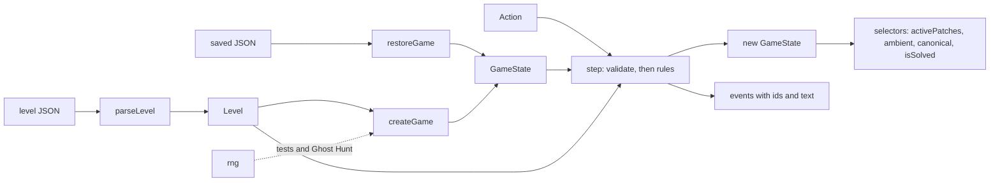

# Design: level-engine

Brief: [docs/briefs/level-engine.md](../../../docs/briefs/level-engine.md), including section 12 (Amendments). If this file disagrees with the brief, the brief wins.

## Overview

The engine is a set of pure functions in `src/engine/`. A level is validated once by `parseLevel`. A game is a `GameState` value (plain JSON data); `step` returns a new state and a list of events. The shell later turns `activePatches(level, state)` into page changes, turns events into live-region announcements, and resumes saved progress with `restoreGame`.

## Files

| File | Holds |
|---|---|
| `wcag.ts` | WCAG table, `understandingUrl` |
| `words.ts` | `countWords`, `isKebabCase`, `isSingleSentence` |
| `schema.ts` | zod shape schemas, inferred types, `ERROR_CODES` (15) |
| `parse.ts` | `parseLevel`: shape check, path mapping, tolerant rule checks |
| `rng.ts` | seeded generator |
| `events.ts` | `EVENT_KINDS` (9), event and action types |
| `state.ts` | `GameState` and its zod schema, `createGame`, `AMBIENT_MIN`, `HISTORY_LIMIT` |
| `rules.ts` | the `Rules` type and `defaultRules` |
| `selectors.ts` | `isSolved`, `remaining`, `progress`, `activePatches` (default implementations) |
| `invariants.ts` | `checkInvariants` |
| `restore.ts` | `restoreGame(level, saved: unknown)` |
| `engine.ts` | `createEngine(overrides?)`, default engine, `step` |
| `index.ts` | the barrel: the only public entry |

## Components

- **Rules.** `Rules` is an object of small functions: `validate`, `pick`, `release`, `snapshot`, `restore`, `ambient`, `canonical`, plus `solved`, `activePatches` and `reset` (Decisions 24). `createEngine(overrides)` spreads `overrides` over `defaultRules` and returns `{ createGame, step, isSolved, remaining, progress, activePatches, ambient, canonical, checkInvariants, restoreGame }`. The default engine is `createEngine()`; the barrel re-exports its members as plain functions.
- **Validate.** `validate(level, state, action)` returns `{ ok: true }` or `{ ok: false, reason }`, with `reason` one of `unknown-ghost`, `unknown-repair`, `already-released`. `step` calls it first. A rejected action returns the same state object and one `rejected` event.
- **Step.** After `validate` passes, `step` runs the action:
  - `meet`: returns the same state object and one `ghost-met` event.
  - `repair`: `pick`, then `release` (a correct repair), pushes one snapshot, adds 1 to the step counter.
  - `undo`: pops the newest snapshot and `restore`s it; with empty history it returns the same state object and `nothing-to-undo`.
  - `reset`: pushes one snapshot, sets every ghost to haunting, nothing picked, 0 attempts, adds 1 to the step counter, emits `level-reset`.
- **History.** Newest last. Oldest dropped past 100 entries.
- **Events.** See the payload table below.
- **Ambient.** `AMBIENT_MIN + (1 - AMBIENT_MIN) * released / total`.
- **Canonical.** A JSON string of `[ghostId, status, picked]`, sorted by ghost id so key order never matters.
- **activePatches.** For each ghost in level order, if `picked` is not null, the patches of that repair in order. Decoys count.
- **restoreGame.** Parses `saved` with the `GameState` zod schema, then runs `checkInvariants`. It returns the parsed copy or `null`.
- **Words.** A word is a run of non-space characters. The 14-word, 20-word and 40-word limits count words in the whole text.

### Event payloads

| Kind | Fields besides `kind` |
|---|---|
| `ghost-met` | `ghost` |
| `repair-chosen` | `ghost`, `repair`, `correct`, `why` (decoy only) |
| `focus-restored` | `ghost` |
| `ghost-released` | `ghost`, `releaseLine` |
| `level-solved` | `level` |
| `undone` | `level` |
| `level-reset` | `level` |
| `nothing-to-undo` | `level` |
| `rejected` | `reason`, `ghost`, `repair` (when the action had one) |

`ghost` and `repair` are ids. `level` is the level id.

## Data contract

Fixed by brief §5 and §6. Types are `z.infer` of the schemas in `schema.ts`. `seenBy` keys are `axe`, `levelCheck` and `walk` (the three `LayerId` values).

`parseLevel` works in three steps:

1. **Shape check.** `schema.ts` (zod) reads types and structure. Every zod issue is mapped to a code by its path (table below). Shape problems never stop step 2.
2. **Rule checks.** A tolerant reader walks the raw input and checks every rule it can read: it skips a value only when that value has the wrong type. Ghosts and repairs that cannot be read are skipped one by one, not the whole level.
3. **Merge.** Errors from both steps are joined and de-duplicated by (code, path). If the list is empty, the zod output is returned as `level`.

| Problem | Code |
|---|---|
| Level id or a ghost id is not kebab-case | `level-id-invalid` |
| Fewer than 1 or more than 8 ghosts | `ghost-count` |
| Two ghosts share an id | `ghost-id-duplicate` |
| Fewer than 2 or more than 4 repairs | `repair-count` |
| No repair is correct | `no-correct-repair` |
| More than one repair is correct | `multiple-correct-repairs` |
| A decoy has no `why` (or an empty one) | `decoy-without-reason` |
| The correct repair has a `why` | `correct-with-reason` |
| `line` or `releaseLine` over 14 words; `lesson` over 40; `why` over 20 words or more than one sentence; label over 60 characters | `line-too-long` |
| `wcag.sc` is not in the table, or its name or level differs from the table | `wcag-unknown` |
| Ghost `selector` is missing or empty | `selector-empty` |
| All `seenBy` flags are false | `layers-none` |
| `exit.selector` is missing or empty | `exit-selector-missing` |
| Anything wrong inside a patch (unknown `op`, missing field, empty `selector`, `name` or `css`), or a repair has no patch | `patch-invalid` |
| Any other shape problem (not an object, wrong type, unknown chapter) | `schema-invalid` |

Path mapping for zod issues: a path ending `ghosts.<i>.selector` gives `selector-empty`; `exit.selector` gives `exit-selector-missing`; a path through `patches.<j>` gives `patch-invalid`; a path through `wcag.<k>` gives `wcag-unknown`; anything else gives `schema-invalid`.

## Correctness Properties

Each property is a fast-check test with at least 200 runs. Each is written as a checker `pN(engine)` in `tests/property/engine/props/`, so that the property test runs it on the real engine and the mutant test runs it on broken engines. (P7 and P9 act on `rng` and `parseLevel`, which have no overrides, so they have no checker module.)

- **P1 Idempotent:** choosing the same repair for a ghost twice gives the same canonical state as once.
- **P2 Commutes across ghosts:** actions that target different ghosts can be reordered without changing the final canonical state.
- **P3 Every ghost is necessary:** for any valid level, leaving any one ghost's correct repair out leaves the level unsolved.
- **P4 Sufficient:** applying every ghost's correct repair, in any order and with decoys tried first, solves the level.
- **P5 Undo restores:** after any state-changing action (`repair` or `reset`), `undo` returns exactly the previous canonical state. With empty history it changes nothing and emits `nothing-to-undo`.
- **P6 Ambient is bounded and monotone:** always within [`AMBIENT_MIN`, 1], equal to `AMBIENT_MIN` when nothing is released and to 1 when everything is, and never lower after one more ghost is released (without undo).
- **P7 Seeded randomness:** the same seed gives the same sequence; forks with different labels are independent; `shuffle` returns a permutation; `pick` returns a member.
- **P8 Fuzz:** any sequence of valid and invalid actions never throws, and `checkInvariants` stays empty. Invalid actions change nothing and emit `rejected`. The test deep-freezes every level and state it passes in (an in-place change throws), checks that `step` with the same inputs gives deep-equal results, and checks that every state survives a JSON round trip and `restoreGame`.
- **P9 Data:** every generated valid level parses and round-trips through JSON; breaking exactly one rule in a valid level fails with exactly the matching error code.
- **P10 Decoys never release:** picking a decoy never releases the ghost and always emits that decoy's `why` word for word (in the `repair-chosen` event).
- **P11 Patches mirror the picks:** after any action, `activePatches` holds exactly the patches of every ghost's picked repair, decoys included, in ghost order then patch order; after `undo` it equals what it was before the undone action; after `reset` it is empty.

### How each checker works

- **P6** checks three things: the bound after every action, the two ends (`createGame` gives `AMBIENT_MIN`; a level with every correct repair applied gives 1), and a release-by-release walk that never decreases.
- **P8** deep-freezes with a helper in its own file. The helper is applied to the level, to the state and to each action before every `step`. It calls `step` twice with the same inputs and compares the results with deep equality. For each state it checks `JSON.parse(JSON.stringify(state))` deep-equals the state and `restoreGame(level, thatCopy)` deep-equals the state.
- **P9** has one fault builder per code (15). A coverage assertion checks that the builder names equal `ERROR_CODES`, so a new code cannot go untested. For any generated level and any code, the faulted level gives errors whose set of codes is exactly that code.
- **P11** computes the expected patch list from the state's `picked` values and the level only, with its own code, not with `activePatches`.

### Mutants and the property each one must fail

| # | Mutant (built with `createEngine(overrides)`) | Property that fails |
|---|---|---|
| 1 | `pick` that toggles the pick back off when chosen twice | P1 |
| 2 | `pick` that depends on the last ghost touched (order) | P2 |
| 3 | `solved` that ignores the last ghost in the level (a necessary ghost that does not count) | P3 |
| 4 | `release` that never releases the last ghost | P4 |
| 5 | `snapshot` that forgets `picked` | P5 |
| 6 | `reset` that pushes no history, so it cannot be undone | P5 |
| 7 | `ambient` that falls at the third release (it halves the rise from then on) | P6 |
| 8 | `ambient` that falls back to `AMBIENT_MIN` when the last ghost is released | P6 |
| 9 | `validate` that lets an unknown id through, then `pick` crashes | P8 |
| 10 | `pick` that changes the state it was given in place | P8 |
| 11 | a decoy that releases | P10 |
| 12 | `activePatches` that ignores decoy picks | P11 |

That is 12 mutants (the brief asks for at least 10). Each mutant test also asserts that the real engine passes the same checker.

## Test layout

- `tests/property/fc-config.ts`: reads `FC_SEED` and exports shared fast-check parameters (`numRuns` 200, `seed` when `FC_SEED` is a valid integer). Every property test passes these parameters.
- `tests/property/arbitraries.ts`: `levelArb`, `actionsArb(level)`, `faultArb`.
- `tests/fixtures/levels/`: `valid-3-ghost.json` and `single-faults.ts`, one variant per error code.

## Decisions

Choices where the brief is silent (simplest option), and notes where this spec adds detail to the brief.

1. **`schema-invalid`.** The brief now lists it as the 15th code (amendment 1). It covers input that is not an object, a wrong type or an unknown chapter, when no other code explains it. P9 breaks all 15 codes.
2. **Kebab-case ghost ids.** A bad ghost id reports `level-id-invalid`, with the path pointing at the ghost.
3. **Label rule.** The check is: not empty, at most 60 characters, first character an uppercase letter. A machine cannot check "starts with a verb". The 60-character limit reports `line-too-long`. A label that fails the uppercase rule reports `schema-invalid`.
4. **"First person" and "one sentence".** First person is not machine-checked. `why` must hold one sentence: at most one terminal `.`, `!` or `?`, at the end. A `why` with two sentences reports `line-too-long`.
5. **Word limits.** `line`, `releaseLine`, `lesson` and `why` count words in the whole text.
6. **Actions take ids.** `meet(ghost)` and `repair(ghost, repair)` carry ghost and repair ids (strings).
7. **`meet`.** It returns the same state object (not a copy), adds no history entry, does not move the step counter and emits `ghost-met`. It works on a released ghost. An unknown ghost is rejected. (Replaces the first version, which said `meet` changed no state but was silent about the object and the counter.)
8. **`repair` history.** Every accepted `repair` increments `attempts`, pushes one history entry and moves the step counter, including a repeat of the same pick. A repeat leaves the canonical state unchanged (P1).
9. **Undo scope.** The snapshot holds the whole per-ghost record (`status`, `picked`, `attempts`). Undo restores all three. The step counter keeps counting and is never restored.
10. **Step counter.** It increases by 1 for each accepted `repair`, `undo` (with history) and `reset`. `meet`, a rejected action and an `undo` with empty history leave the state object, and so the counter, unchanged.
11. **`reset`.** It is undoable. It pushes one history entry (also when every ghost is already haunting, so P5 holds with no special case), then returns the fresh ghost record and emits `level-reset`, never `undone`. It keeps the seed. It does not clear history. (Replaces the first version, where reset cleared history and emitted `undone`.)
12. **`nothing-to-undo`.** An `undo` with empty history returns the same state object and emits `nothing-to-undo`.
13. **Solved level.** After `level-solved`, `repair` on any ghost is rejected as `already-released`. `undo` and `reset` still work.
14. **Seed.** The seed is an unsigned 32-bit integer. The generator is mulberry32 with one 32-bit state, so its state is one number. `fork(label)` mixes the label (FNV-1a hash) with the current state into a new generator and does not advance the parent.
15. **`rng.int(min, max)`** is inclusive on both ends. `pick` and `shuffle` do not change their input; `shuffle` is Fisher-Yates on a copy.
16. **`progress`** returns `{ released, total }`. **`remaining`** returns the ids of ghosts still haunting, in level order.
17. **`overrides`** is `Partial<Rules>`. A rule receives plain data and returns plain data.
18. **Invariant list.** `checkInvariants` checks: state ghost ids equal level ghost ids; a released ghost has a picked repair that is correct; a haunting ghost has no picked correct repair; `picked` names a repair of that ghost; `attempts` is a non-negative integer; the history has at most 100 entries; each history snapshot has the same ghost ids and a `picked` that names a repair of that ghost (or null); the step counter is a non-negative integer; the seed is a 32-bit unsigned integer.
19. **Fast-check settings.** `FC_SEED` is read in `tests/property/fc-config.ts`, which the brief now lists among the files this spec owns. A missing or non-integer value is ignored.
20. **Fixtures as data.** The valid level is JSON; the single-fault variants are made by a function over a clone of it, so each differs from the valid level in one rule.
21. **Purity test.** It calls `new ESLint({ overrideConfigFile: 'eslint.config.js' })` and `lintText(snippet, { filePath: 'src/engine/bad.ts' })`.
22. **Barrel.** `index.ts` also re-exports `clamp` and `restoreGame`. Nothing else outside the barrel is public.
23. **`LayerId`.** The brief names `LayerId` but uses it only as the keys of `seenBy`. The spec keeps both: `LayerId` is the string union and `seenBy` uses the keys `axe`, `levelCheck`, `walk`.
24. **Three extra rules.** The brief's rule list (`validate`, `pick`, `release`, `snapshot`, `restore`, `ambient`, `canonical`) cannot express three required mutants: a necessary ghost that does not count, an `activePatches` that ignores decoy picks, and a reset that cannot be undone. So `Rules` also holds `solved(level, state)`, `activePatches(level, state)` and `reset(level, state, snapshot)`. `isSolved` and the `level-solved` event use `solved`; `step` passes `snapshot(state)` to `reset`, which pushes it on the history. This extends the brief's list and does not contradict it.
25. **`GameState` shape.** `{ ghosts: Record<ghostId, { status, picked: string | null, attempts }>, history: Snapshot[], step: number, seed: number }`, with `Snapshot` the same `ghosts` record. No `undefined` values: `picked` uses `null`. A zod schema in `state.ts` defines it, and `restoreGame` reuses it.
26. **`restoreGame`.** Unknown keys in `saved` are dropped by the schema. It returns a fresh copy and never the object it was given.
27. **Parse errors.** `message` is one short sentence per error that follows the story bible word limit, with no real brands.
28. **Event field names.** As in the payload table: `ghost`, `repair`, `correct`, `why`, `releaseLine`, `level`, `reason`.
29. **Task numbers.** Adding `restoreGame` and P11 moved the later task numbers up; the first spec had 29 tasks and this one has 31. Requirement numbers R1 to R45 are unchanged; R46 to R49 are new.
30. **wcag must not be empty.** An empty wcag array fails the shape check and reports `schema-invalid` (the brief has no code for it).
31. **Repair ids.** Repair ids are unique per ghost by contract (the generators and fixtures keep them so). `parseLevel` does not check it, because the brief has no code for it. `step` uses the first repair with a matching id.
32. **Empty level.** With zero ghosts `isSolved` is true and `ambient` is 1. `parseLevel` never lets such a level through (`ghost-count`).
33. **Task order.** The rules task (9) uses the default selectors, so it runs after the selectors task (10 now comes first in its `After` line).