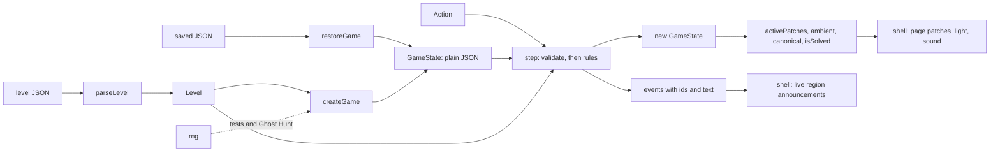

# Engine

The engine is the pure rules of Keyboard Ghosts, in `src/engine/`. It has a data contract for levels, a validator, and a deterministic game engine. It has no DOM, no clock and no randomness of its own. ESLint enforces that for `src/engine/**`.

Brief: [docs/briefs/level-engine.md](../briefs/level-engine.md). Spec: `.kiro/specs/level-engine/`. Decision D2 in [decisions.md](../decisions.md).

The page is a pure function of the base level page and `activePatches(level, state)`. The shell resets the page and applies the patches, so undo and reset need no special cases.

## API

All of it is exported from `src/engine/index.ts`.

| Name | What it does |
|---|---|
| `parseLevel(input)` | Returns `{ ok: true, level }` or `{ ok: false, errors }`. Each error is `{ code, path, message }`. 15 codes. Reports every error it can read. |
| `createGame(level, seed)` | A fresh `GameState`: per ghost `status`, `picked`, `attempts`; plus `history` (limit 100), `step` and `seed`. Plain JSON data. |
| `restoreGame(level, saved)` | A valid `GameState` copy, or `null` when the shape or `checkInvariants` fails. |
| `step(level, state, action)` | Returns `{ state, events }`. Actions: `meet`, `repair`, `undo`, `reset`. `validate` runs first. |
| `isSolved`, `remaining`, `progress` | Selectors for the level goal. |
| `activePatches(level, state)` | The patches of every ghost's picked repair, decoys included. Order: ghost order, then patch order. |
| `ambient(level, state)` | `AMBIENT_MIN` (0.15) with nothing released, 1 with everything released, never lower as ghosts are released. |
| `canonical(state)` | A stable string of ghost id, status and pick. It ignores history, attempts and the step counter. |
| `checkInvariants(level, state)` | A list of violations. Empty when the state is sound. |
| `createEngine(overrides?)` | Builds the engine from rule functions. `overrides` is for tests (mutants). |
| `createRng(seed)` | Seeded generator: `next`, `int`, `pick`, `shuffle`, `fork`, `state`. |
| `EVENT_KINDS` | `ghost-met`, `repair-chosen`, `focus-restored`, `ghost-released`, `level-solved`, `undone`, `level-reset`, `nothing-to-undo`, `rejected`. |
| `WCAG_TABLE`, `understandingUrl(sc)` | The 14 WCAG 2.2 rows and the W3C "Understanding" link. |

### Rules

`createEngine` builds the engine from these functions. Each one can be replaced in a test.

`validate`, `pick`, `release`, `snapshot`, `restore`, `reset`, `ambient`, `canonical`, `solved`, `activePatches`.

### Step counter

The counter counts accepted `repair`, `undo` and `reset` actions. `meet`, a rejected action and an `undo` with empty history return the same state object.

### Events

Every event carries the ids it is about. `repair-chosen` also carries `correct` and, for a decoy, `why`. `ghost-released` carries `releaseLine`. `rejected` carries `reason` (`unknown-ghost`, `unknown-repair`, `already-released`). A correct repair emits `repair-chosen`, `focus-restored`, `ghost-released`, then `level-solved` if it was the last. `reset` emits `level-reset`, never `undone`.

## Properties

Each property is a fast-check test with at least 200 runs (`tests/property/engine/`). The seed can be fixed with `FC_SEED`.

| Property | The bug it would catch |
|---|---|
| P1 Idempotent | A repair that changes the state again when it is chosen twice. |
| P2 Commutes across ghosts | A rule that reads hidden order, such as "the ghost touched last". |
| P3 Every ghost is necessary | A level that counts as solved while one ghost is still haunting. |
| P4 Sufficient | A level that cannot be solved, or a decoy that blocks the way. |
| P5 Undo restores | Undo that forgets a field, or a reset that cannot be undone. |
| P6 Ambient is bounded and monotone | Light that dims when a ghost is released, or that does not reach 1 at the end. |
| P7 Seeded randomness | A generator that depends on global state, or a shuffle that loses items. |
| P8 Fuzz | A crash on a bad id, a change to an input in place, a step that is not deterministic, a state that does not survive JSON. |
| P9 Data | A valid level that is refused, or a broken rule that gives the wrong error code. |
| P10 Decoys never release | A decoy that releases a ghost, or that announces the wrong reason. |
| P11 Patches mirror the picks | A page that does not show a wrong repair, or keeps patches after undo or reset. |

## Mutants

`tests/property/engine/mutants.test.ts` builds broken engines with `createEngine(overrides)`. Each must fail the property named here, and the real engine must pass it. A property that cannot fail is not a property.

| # | Mutant | Property that fails |
|---|---|---|
| 1 | a pick that toggles off when chosen twice | P1 |
| 2 | a pick that depends on the ghost touched last | P2 |
| 3 | a necessary ghost that does not count | P3 |
| 4 | a release that never releases the last ghost | P4 |
| 5 | a snapshot that forgets the pick | P5 |
| 6 | a reset that cannot be undone | P5 |
| 7 | an ambient that falls at the third release | P6 |
| 8 | an ambient that falls back to `AMBIENT_MIN` at the last release | P6 |
| 9 | a `validate` that lets an unknown id through and then crashes | P8 |
| 10 | a pick that changes its input in place | P8 |
| 11 | a decoy that releases | P10 |
| 12 | an `activePatches` that ignores decoy picks | P11 |

## What the tests cannot see

The engine knows nothing about the page. A repair patch can be valid data and still not fix the barrier in a real level page. That is checked later, in a browser, by the level checks and the automated Tab tests.
